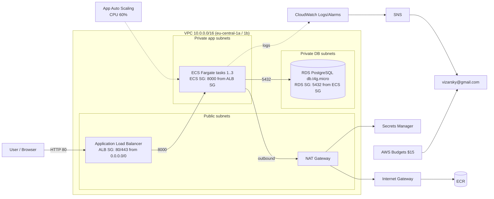

# Containerized Web App on AWS (Terraform + FastAPI + ECS Fargate + RDS)

A FastAPI task manager (REST API + embedded HTML/JS UI) running on **ECS Fargate** behind an **ALB**, backed by **RDS PostgreSQL**, with credentials in **Secrets Manager**, auto scaling, monitoring and a cost budget. All infrastructure is defined in Terraform.

All resources are tagged `Project=final-webapp-project`, `Environment=dev`, `ManagedBy=terraform` (via provider `default_tags`). All alerts go to `vizarsky@gmail.com`.

## 1. Repository layout

```
app/        main.py, database.py, requirements.txt, Dockerfile
terraform/  providers, variables, outputs, vpc, security, iam, ecr, rds, alb, ecs, autoscaling, monitoring, budgets
tests/      load_test.py (async load generator, stdlib only)
```

## 2. Architecture



```
VPC: 10.0.0.0/16 (eu-central-1a / 1b)
=================================================================
                         Internet
                            |
                     +------v-------+      +--------+
 PUBLIC subnets      |     ALB      |      | NAT GW |---> IGW
 10.0.1.0/24, .2/24  | SG: 80, 443  |      +---+----+  (ECR, SM, Logs)
                     +------+-------+          ^
                            | :8000            |
                     +------v-------+          |
 APP subnets         | ECS Fargate  +----------+
 10.0.11.0/24, .12   | 1..3 tasks   |
                     | 8000 from ALB|
                     +------+-------+
                            | :5432
                     +------v-------+
 DB subnets          | RDS Postgres |  (no route to internet)
 10.0.21.0/24, .22   | 5432 from ECS|
                     +--------------+
```

Cost note: a **single NAT Gateway** (first public subnet) is used to save money; the trade-off is no NAT redundancy if `eu-central-1a` fails.

## 3. Technology choices

| Component | Technology | Rationale |
|---|---|---|
| Backend & UI | FastAPI (Python 3.12) | Low memory footprint (runs stably in a 512 MB container), fast start for quick scale-out, built-in `/docs`, lightweight HTML UI on the home page. |
| Container orchestration | Amazon ECS (AWS Fargate) | Serverless containers: no OS patching, kernel updates or EC2 cluster management. Pay only for allocated vCPU/RAM while running. |
| Network & security | VPC + public/private subnets + SG + IAM | Business logic and DB are isolated from the internet. Least privilege: DB accepts connections only from the ECS SG, ECS only from the ALB SG. |
| Database & secrets | RDS PostgreSQL + Secrets Manager + connection pool | Managed relational DB with automated backups and encryption. The password is generated by Terraform and injected into the container via Secrets Manager with no hardcoding. SQLAlchemy pooling (`pool_size=5`, `max_overflow=10`, `pool_pre_ping=True`) prevents connection exhaustion when scaling. |
| Load balancing & scaling | ALB + Application Auto Scaling | ALB spreads traffic across AZs and removes unhealthy containers via `/health`. Auto Scaling adds tasks at peak and removes them when load drops, saving money. |
| Monitoring & budget | CloudWatch + SNS + Budgets + Cost Explorer | Central logs and metrics (CPU/RAM/5XX) with email alerts to <vizarsky@gmail.com>, and a hard financial guardrail. |

Design notes:

- `/health` does **not** query the DB, so a DB hiccup does not make the ALB kill every task. `/health/db` checks DB connectivity.
- DB credentials are delivered **only** through the `secrets` block of the task definition (JSON keys of one secret); there are no plaintext password env vars.
- The execution role (ECR pull, logs, `secretsmanager:GetSecretValue` on one secret) and the task role (write own logs only) are scoped to specific resources.
- RDS subnets have no route to the internet.
- HTTPS (443) is open on the ALB SG, but only an HTTP:80 listener exists; adding HTTPS needs an ACM certificate and a domain.

## 4. Deployment (CLI)

Prerequisites: AWS CLI configured (`aws sts get-caller-identity`), Terraform >= 1.5, Docker.

The ECS service needs an image in ECR, so deploy in two steps: create ECR first, push, then everything else.

```bash
cd terraform
terraform init

# 1) Create the ECR repository only
terraform apply -target=aws_ecr_repository.app -target=aws_ecr_lifecycle_policy.app

# 2) Build and push the image (linux/amd64 matches the task definition)
ECR_URL=$(terraform output -raw ecr_repository_url)
aws ecr get-login-password --region eu-central-1 | docker login --username AWS --password-stdin "${ECR_URL%%/*}"
docker build --platform linux/amd64 -t "${ECR_URL}:latest" ../app
docker push "${ECR_URL}:latest"

# 3) Create everything else (~10-15 min, RDS is the slowest)
terraform plan -out tfplan
terraform apply tfplan

# 4) Get the URL and test
URL=$(terraform output -raw alb_dns_name)
curl "$URL/health"
curl -X POST "$URL/api/tasks" -H 'Content-Type: application/json' -d '{"title":"first task"}'
curl "$URL/api/tasks"
```

**Confirm the SNS subscription**: AWS sends a confirmation email to `vizarsky@gmail.com`; click *Confirm subscription*, otherwise alarm emails are not delivered. Budget emails need no confirmation.

### Verification in the AWS Console

| What | Where | Expected |
|---|---|---|
| VPC | VPC > Your VPCs / Subnets | `10.0.0.0/16`, 6 subnets in 2 AZs |
| Security groups | EC2 > Security Groups | ALB: 80/443 from anywhere; ECS: 8000 from ALB SG; RDS: 5432 from ECS SG |
| ECR | ECR > Repositories | `final-webapp` with the `latest` image and a lifecycle policy |
| RDS | RDS > Databases | `db.t4g.micro`, Single-AZ, gp3 20 GB, encrypted, not publicly accessible |
| Secrets | Secrets Manager | `final-webapp/db-credentials` |
| ALB | EC2 > Target Groups | Targets `healthy`, health check `/health` |
| ECS | ECS > Clusters > service | 1 running task, Container Insights enabled, `secrets` listed in the task definition (no plaintext password) |
| Auto Scaling | ECS service > Configuration and networking > Service auto scaling | min 1 / max 3, target 60% CPU |
| Logs | CloudWatch > Log groups | `/ecs/final-webapp` has app logs |
| Alarms | CloudWatch > Alarms | `cpu-high`, `alb-5xx`, `unhealthy-hosts` (state `OK`) |
| Budget | Billing > Budgets | `final-webapp-monthly` $15 with 50/80/100% alerts |

## 5. Load test and Auto Scaling

`tests/load_test.py` is an asyncio script (Python stdlib only). It hammers the CPU-bound `/api/cpu` endpoint plus light endpoints (`/health`, `/api/tasks`).

```bash
python3 tests/load_test.py "$URL" --concurrency 60 --duration 300 --cpu-ms 200
```

Watch scaling while it runs:

```bash
watch -n 15 'aws ecs describe-services --cluster final-webapp-cluster --services final-webapp-service \
  --query "services[0].{desired:desiredCount,running:runningCount}" --region eu-central-1'
aws application-autoscaling describe-scaling-activities --service-namespace ecs --region eu-central-1
```

Also check CloudWatch > Metrics > ECS > `CPUUtilization` and the `cpu-high` alarm (an email arrives when it fires).

### Results

> **Not yet filled in**: this repository was generated without deploying to AWS. After running the test, replace the placeholders below with real numbers.

| Metric | Value |
|---|---|
| Test parameters | `<concurrency>` workers, `<duration>` s |
| Total requests / success rate | `<…>` |
| Throughput (req/s) | `<…>` |
| Latency p50 / p95 / p99 | `<…>` |
| Peak average CPU | `<…>`% |
| Tasks: before -> peak -> after cooldown | 1 -> `<…>` -> `<…>` |
| `cpu-high` alarm fired / email received | `<yes/no>` |

Scale-out starts about 1-3 minutes after CPU exceeds 60% (target tracking needs 3 one-minute datapoints; cooldown 60 s). Scale-in is slower (about 15 minutes of low CPU).

## 6. Cost analysis (Cost Explorer)

1. Billing and Cost Management > **Cost Explorer**. Enable it on first use (data appears after up to 24 h).
2. Set the date range to the current month, granularity **Daily**.
3. **Group by: Service**. Expect the main costs to be EC2-Other (NAT Gateway), Elastic Load Balancing, ECS (Fargate), RDS.
4. **Filter > Tag > `Project` = `final-webapp-project`** to isolate this project. Activate `Project`, `Environment` and `ManagedBy` as **cost allocation tags** under Billing > Cost allocation tags (takes up to 24 h to apply).
5. Group by **Usage type** to see NAT hours vs. data processed, or Fargate vCPU vs. GB hours.
6. Compare with the **Budgets** page (forecast vs. $15).

Rough monthly estimate (eu-central-1, approximate, check the AWS Pricing Calculator): NAT Gateway ~$40, ALB ~$18, RDS t4g.micro + 20 GB ~$15, Fargate 256/512 per task ~$9, Secrets Manager ~$0.40, plus logs. That is about **$80/month if left running 24/7, well over the $15 budget**, so run it for a few hours or days for the practice and destroy it when done. The budget alerts will fire early if it is left running.

## 7. Cleanup

```bash
cd terraform
terraform destroy
```

Check afterwards that no NAT Gateway, Elastic IP, ALB or RDS instance remains in the console.

## 8. Local run (optional)

```bash
docker run -d --name pg -e POSTGRES_PASSWORD=pw -e POSTGRES_DB=webapp -p 5432:5432 postgres:16
cd app && pip install -r requirements.txt
DB_HOST=localhost DB_USER=postgres DB_PASSWORD=pw uvicorn main:app --port 8000
```
